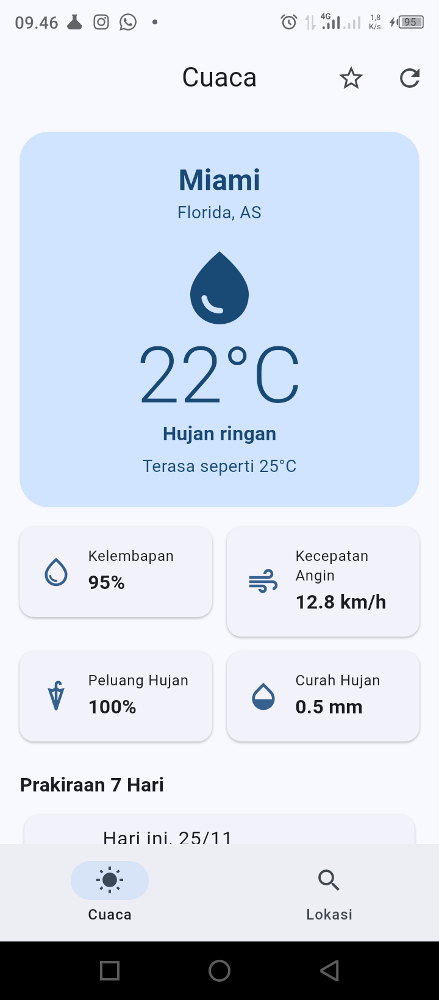
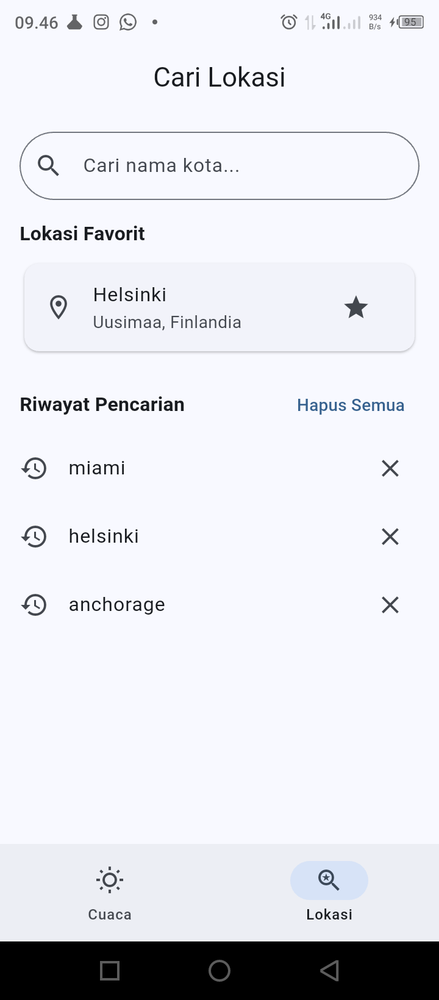

# Responsi Praktikum Pemrograman Mobile (Dart)

**Nama**        : Biladi Amna   
**NIM**         : H1D024074   
**Shift**       : Awal E / Akhir C    
**Praktikum**   : Pemrograman Mobile

Aplikasi cuaca Flutter yang memakai API Open-Meteo. Memiliki fitur pencarian kota, tampilan cuaca terkini dan prakiraan 7 hari, serta penyimpanan lokasi favorit dan riwayat pencarian di Local Storage. Dibuat untuk memenuhi tugas Responsi Pemrograman Mobile.

---

## 1. Struktur Aplikasi

```
lib/
├── main.dart                     # Entry point, Theme Material 3 & Typography
├── bloc/
│   └── weather_bloc.dart         # Pemanggil API + konversi JSON → model
├── helpers/
│   ├── api.dart                  # HTTP GET (package http), timeout, penanganan status code
│   ├── api_url.dart              # Pembentuk URL endpoint Open-Meteo
│   ├── app_exception.dart        # Custom exception
│   ├── local_storage.dart        # SharedPreferences (favorit, riwayat, lokasi terakhir)
│   └── weather_helper.dart       # Weather code → teks & ikon, format suhu/tanggal
├── model/
│   ├── cuaca.dart                # CuacaSaatIni, PrakiraanHarian, DataCuaca
│   └── lokasi.dart               # Lokasi
├── viewmodel/
│   └── weather_viewmodel.dart    # State & logika (ChangeNotifier), enum StatusData
├── ui/
│   ├── main_page.dart            # Bottom NavigationBar, pemilik ViewModel
│   ├── weather_page.dart         # Screen 1: Cuaca
│   └── search_page.dart          # Screen 2: Cari Lokasi
└── widget/
    ├── forecast_item.dart        # Item prakiraan harian
    ├── info_tile.dart            # Kartu info (kelembapan, angin, dll.)
    └── message_view.dart         # Tampilan error / data kosong
```

---

## 2. Implementasi API (Open-Meteo)

Semua request memakai **HTTP GET** lewat dependency `http`. Response JSON diubah menjadi model Dart (`fromJson`).

| Kebutuhan | Endpoint                                         | Parameter penting                                                               |
| ---       | ---                                              | ---                                                                             |
| Cari kota | `https://geocoding-api.open-meteo.com/v1/search` | `name`, `count=10`, `language=id`, `format=json`                                |
| Cuaca     | `https://api.open-meteo.com/v1/forecast`         | `latitude`, `longitude`, `current`, `daily`, `timezone=auto`, `forecast_days=7` |

**Pemetaan field API ke tampilan**

| Data                  | Field API                                                                                |
| ---                   | ---                                                                                      |
| Suhu saat ini         | `current.temperature_2m`                                                                 |
| Kelembapan            | `current.relative_humidity_2m`                                                           |
| Suhu terasa           | `current.apparent_temperature`                                                           |
| Curah hujan           | `current.precipitation`                                                                  |
| Kode kondisi cuaca    | `current.weather_code`                                                                   |
| Kecepatan angin       | `current.wind_speed_10m`                                                                 |
| Suhu max / min harian | `daily.temperature_2m_max` / `daily.temperature_2m_min`                                  |
| Peluang hujan         | `daily.precipitation_probability_max` (hari pertama dipakai untuk kartu "Peluang Hujan") |

---

## 3. Penerapan MVVM

| Komponen MVVM | Implementasi                       | Kegunaan                                                                       |
| ---           | ---                                | ---                                                                            |
| **Model**     | `model/` + `bloc/` + `helpers/`    | Struktur data, akses API, dan Local Storage                                    |
| **View**      | `ui/` + `widget/`                  | Menampilkan UI dan meneruskan aksi pengguna ke ViewModel                       |
| **ViewModel** | `viewmodel/weather_viewmodel.dart` | Menyimpan state, memanggil `bloc` dan `LocalStorage`, lalu `notifyListeners()` |

Alur data: `View → ViewModel → Bloc/Helpers → API / Storage`, lalu `ViewModel.notifyListeners() → View (setState)`.

---

## 4. Menjalankan Aplikasi
1. Clone repositori dari GitHub
```bash
git clone https://github.com/bilxdi/H1D024074-Praktikum-Mobile-Dart-Responsi.git
```

2. Masuk ke direktori proyek
```bash
cd H1D024074-Praktikum-Mobile-Dart-Responsi
```

3. Unduh dependensi (packages)
```bash
flutter pub get
```

4. Jalankan Aplikasi
```bash
flutter run
```

## 5. Screenshot Aplikasi

